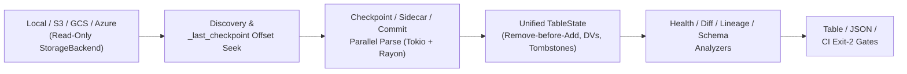
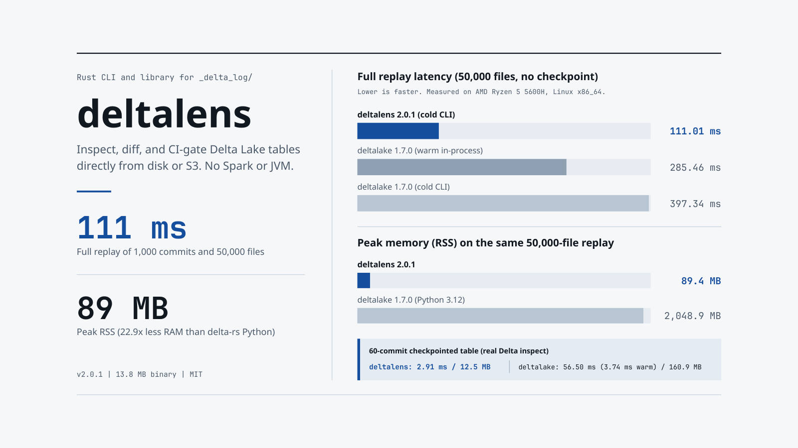

# DeltaLens

**Standalone CLI & Rust library to inspect, diff, trace, and audit Delta Lake tables from your terminal — no Spark, no JVM, no Python.**

[](https://crates.io/crates/deltalens)
[](https://docs.rs/deltalens)
[](https://github.com/sandy-sachin7/deltalens/releases)
[](https://github.com/sandy-sachin7/deltalens/actions/workflows/ci.yml)
[](https://www.rust-lang.org)
[](LICENSE)

Native Rust binary that reads `_delta_log/` metadata directly — including NDJSON commits, classic & multi-part Parquet checkpoints, V2 checkpoints with `_sidecars/`, `.compacted.json` files, Deletion Vectors, Column Mapping renames, and Liquid Clustering — across local disks, AWS S3, Google Cloud Storage, and Azure Data Lake.

<p align="center">
  
</p>

> **Deep dive & full benchmarks:** [Inspecting 50,000-File Delta Lake Tables in 111ms & 89MB RAM Without a JVM](https://sandy-sachin7.github.io/deltalens/)

---

## See It in Action

### Table health, Deletion Vectors, tombstones, checkpoints & skew

```text
$ deltalens inspect ./transactions --plain
+---------------------------------+---------------------------------------------------------------------------------------------------------+
| deltalens · Table Health Report | ./transactions                                                                                          |
+===========================================================================================================================================+
| Current Version                 | v012                                                                                                    |
| Created                         | 2025-10-09 08:53:20 UTC                                                                                 |
| Last Modified                   | 2025-10-20 22:40:00 UTC                                                                                 |
| Protocol                        | reader=3, writer=7 (r:[columnMapping, deletionVectors], w:[columnMapping, deletionVectors, clustering]) |
|---------------------------------+---------------------------------------------------------------------------------------------------------|
| DATA FILES                      |                                                                                                         |
| Total Files                     | 14                                                                                                      |
| Total Size                      | 345.8 MB                                                                                                |
| Avg / Min / Max File Size       | 24.7 MB / 524.3 KB / 134.2 MB                                                                           |
| Small Files (<32MB)             | 10 (71.4%)                                                                                              |
| Skew Score                      | 0.85 / 1.0                                                                                              |
| Deletion Vectors                | 1 files (1420 deleted rows)                                                                             |
|---------------------------------+---------------------------------------------------------------------------------------------------------|
| PARTITIONS & MAINTENANCE        |                                                                                                         |
| Partition Columns               | region (3 partitions, 0 empty)                                                                          |
| Last CHECKPOINT                 | v010                                                                                                    |
| Clustering Columns              | customer_id, txn_id                                                                                     |
| Active Tombstones               | 3 (228.6 MB reclaimable), oldest 2025-09-16                                                             |
| SCHEMA                          | 5 columns · 1 schema change in analyzed log                                                             |
+---------------------------------+---------------------------------------------------------------------------------------------------------+

WARN: 2 issues detected:
  - High file size skew (0.85 / 1.0)
  - High small-file ratio: 10 of 14 files (71.4%) are < 32 MB
```

### Recursive schema diff & CI breaking-change gate (exit code `2`)

```text
$ deltalens diff ./transactions --v1 10 --v2 12 --plain --fail-on-breaking
+---------------------------------------+--------------------------------------------------------------------------------------------------------+
| deltalens · Version Diff  v010 → v012 | ./transactions                                                                                         |
+================================================================================================================================================+
| SCHEMA CHANGES                        |                                                                                                        |
| + added                               | currency                                                                                               |
| - removed [BREAKING]                  | legacy_code                                                                                            |
| → renamed [BREAKING]                  | customer_id → account_id                                                                               |
| ~ modified [BREAKING]                 | amount (double → integer)                                                                              |
| ~ nullable [BREAKING]                 | amount (true → false)                                                                                  |
|---------------------------------------+--------------------------------------------------------------------------------------------------------|
| DATA CHANGES                          |                                                                                                        |
| Files Added / Removed / Net           | +3 / -1 / +2                                                                                           |
| Size Added / Removed / Net            | 243.3 MB / 134.2 MB / +109.1 MB                                                                        |
|---------------------------------------+--------------------------------------------------------------------------------------------------------|
| OPERATIONS (2 commits)                | MERGE (1), WRITE (1)                                                                                   |
| PARTITION CHANGES                     | New: 1 (region=ap-south) · Removed: 0                                                                  |
+---------------------------------------+--------------------------------------------------------------------------------------------------------+
# exits with code 2 because breaking schema changes were detected
```

---

## 30-Second Quickstart

### 1. Install

**Linux & macOS (one-liner with strict SHA-256 verification)**

```bash
curl -fsSL https://raw.githubusercontent.com/sandy-sachin7/deltalens/main/scripts/install.sh | bash
```

**Windows (PowerShell)**

```powershell
irm https://raw.githubusercontent.com/sandy-sachin7/deltalens/main/scripts/install.ps1 | iex
```

**Cargo (crates.io)**

```bash
# Full build with AWS S3, GCS, and Azure backends (default)
cargo install deltalens

# Air-gapped / pure-local binary (zero cloud or HTTP dependencies)
cargo install deltalens --no-default-features
```

### 2. Inspect, diff, trace, and automate with `jq`

```bash
# Inspect table health (local or cloud URI)
deltalens inspect ./transactions
deltalens inspect s3://my-bucket/warehouse/transactions --fail-on-issues

# Diff two versions and fail CI on breaking schema changes (exit code 2)
deltalens diff ./transactions --v1 10 --v2 12 --fail-on-breaking

# Trace recent writers and audit DELETE/MERGE compliance events
deltalens lineage ./transactions --last 10 --op WRITE
deltalens audit ./transactions --since 2026-04-01 --op DELETE,MERGE

# View full recursive schema evolution history
deltalens schema gs://my-bucket/transactions --history
```

**`jq` automation recipes:**

```bash
# Check small-file percentage & skew score in monitoring scripts
deltalens inspect ./transactions --json | jq '{version: .current_version, small_pct: .health.small_file_pct, skew: .health.skew_score}'

# Alert when expired tombstones exceed 1 GiB (VACUUM needed)
deltalens inspect ./transactions --json | jq -e '.tombstones.expired_reclaimable_bytes < 1073741824'

# Extract active Deletion Vector deleted rows and Liquid Clustering columns
deltalens inspect ./transactions --json | jq '{dv_files: .health.deletion_vector_files, dv_rows: .health.deleted_rows_in_dvs, clustering: .maintenance.clustering_columns}'

# List breaking schema changes between versions as JSON
deltalens diff ./transactions --v1 10 --v2 12 --json | jq '.schema_changes[] | select(.has_breaking_changes)'
```

---

## Why Not Just Use Spark?

| Approach | Typical latency (60-commit table) | Runtime required | Command |
| :--- | :--- | :--- | :--- |
| Spark SQL | 10–30 s (cold JVM) | JVM + Spark cluster | `DESCRIBE HISTORY` |
| Databricks SQL | 5–15 s (cold warehouse) | Active SQL warehouse | `DESCRIBE HISTORY` |
| delta-rs (Python) | 56.5 ms cold / 3.7 ms warm | Python + venv + wheels | `DeltaTable.history()` |
| **DeltaLens** | **2.9 ms cold CLI** (111 ms on 50k files) | **Single binary** | `deltalens inspect` / `lineage` |

DeltaLens reads only `_delta_log/` metadata (checkpoints, sidecars, compacted logs, and JSON commits) — never Parquet data files. Use **DeltaLens** for instant observability, debugging, and CI/CD quality/schema gates; use **Spark** or **delta-rs** when querying row data or running SQL joins.

---

## Architecture



- **Zero nested runtimes**: Cloud backends fetch objects concurrently via a shared Tokio `buffer_unordered(32)` stream; local disk I/O and CPU-bound NDJSON/Arrow-Parquet parsing parallelize via Rayon.
- **`_last_checkpoint` offset listing**: Snapshot and diff commands on cloud stores read `_last_checkpoint` and call `list_with_offset` to skip listing thousands of pre-checkpoint commits, falling back automatically when inspecting pre-checkpoint history or stale hints.
- See [ARCHITECTURE.md](ARCHITECTURE.md) for the complete module map, replay state machine, and security design.

---

## Delta Lake Protocol Compatibility Matrix

| Protocol Feature | Supported | Details |
| :--- | :---: | :--- |
| NDJSON Commits (`00000...0.json`) | ✅ | Strict 20-digit parsing, structured parse warnings (`-v`) |
| Classic Single-File Parquet Checkpoints | ✅ | Arrow/Parquet reader (`snap`, `zstd`, `flate2`, `lz4`) |
| Multi-Part Parquet Checkpoints (`part-00001-of-N`) | ✅ | Completeness validation + parallel part loading |
| V2 Checkpoints (JSON & Parquet) + `_sidecars/` | ✅ | Validated `_delta_log/_sidecars/` resolution |
| Log Compaction (`.compacted.json`) | ✅ | Contiguous range acceleration + commit precedence |
| `_last_checkpoint` Offset Listing | ✅ | Skips historical pre-checkpoint cloud listings (`inspect`, `schema`, `diff`) |
| Deletion Vectors (DVs) | ✅ | Keyed by `(canonical_path, dv_unique_id)`, DV file & row counts |
| Column Mapping (`id` & `name` modes) | ✅ | Detects column renames via `delta.columnMapping.id` |
| Liquid Clustering (`delta.clustering`) | ✅ | Extracts clustering columns from `domainMetadata` |
| Type Widening & Recursive Schema Diff | ✅ | Nested `struct`/`array`/`map`, safe widenings vs. `[BREAKING]` |
| Tombstone Retention (`deletedFileRetentionDuration`) | ✅ | Tracks active & expired tombstones and reclaimable bytes |
| Protocol Features (`readerFeatures` / `writerFeatures`) | ✅ | Reported in `inspect`; fails loudly on unsupported `minReaderVersion` or `readerFeatures` |

---

## Commands & Exit Codes

| Command | What it does | Key flags |
| :--- | :--- | :--- |
| `inspect <path>` | Table health, file skew, tombstones, DVs, checkpoints, clustering & protocol | `--version <n>`, `--fail-on-issues` |
| `diff <path>` | Logical & physical file deltas, partition diffs, recursive schema diffs | `--v1 <n> --v2 <n>`, `--schema-only`, `--files-only`, `--fail-on-breaking` |
| `lineage <path>` | Writer attribution, row counts & operation timeline | `--last <n>`, `--since <YYYY-MM-DD>`, `--op <ops>`, `--user <u>` |
| `audit <path>` | Compliance audit trail filterable by date range, op, and user | `--since <YYYY-MM-DD>`, `--until <YYYY-MM-DD>`, `--op <ops>`, `--user <u>` |
| `schema <path>` | Active column layout or full recursive schema evolution history | `--history`, `--at <v>` |
| `config` | Manage user settings and local opt-in telemetry | `show`, `path`, `metrics`, `set <key> <value>` |

**Global flags**: `--json` (machine-readable JSON), `--plain` (ANSI-free, honors `NO_COLOR` and non-TTY stdout), `--no-header`, `-v` / `--verbose` (checkpoint discovery and parse warnings to stderr).

**Exit codes**:
- `0` — Success
- `1` — Error (invalid arguments, missing table/version, version gap, storage/auth error)
- `2` — CI gate triggered (`inspect --fail-on-issues` detected health issues, or `diff --fail-on-breaking` detected breaking schema changes)

### GitHub Actions CI/CD Gate Example

Use the built-in composite action (downloads a SHA-256 verified binary and writes output to `$GITHUB_STEP_SUMMARY`):

```yaml
- name: Gate on Delta table health
  uses: sandy-sachin7/deltalens@main
  with:
    command: inspect
    path: s3://my-bucket/warehouse/transactions
    args: --fail-on-issues

- name: Gate on breaking schema changes
  uses: sandy-sachin7/deltalens@main
  with:
    command: diff
    path: s3://my-bucket/warehouse/transactions
    args: --v1 ${{ env.PREV_VER }} --v2 ${{ env.CURR_VER }} --fail-on-breaking
```

---

## Cloud Storage Authentication

DeltaLens supports `s3://`, `s3a://`, `s3n://`, `gs://`, `az://`, `abfs://`, `abfss://`, and `file://` URIs via `object_store`.

### AWS S3 (`s3://`, `s3a://`, `s3n://`)

| Setting | Environment variable(s) |
| :--- | :--- |
| Access keys | `AWS_ACCESS_KEY_ID`, `AWS_SECRET_ACCESS_KEY`, optional `AWS_SESSION_TOKEN` |
| IAM / OIDC roles | Automatic on EC2/ECS/EKS, or `AWS_WEB_IDENTITY_TOKEN_FILE` + `AWS_ROLE_ARN` |
| Region | `AWS_REGION` or `AWS_DEFAULT_REGION` |
| Custom S3-compatible endpoint | `AWS_ENDPOINT` (MinIO, Cloudflare R2, LocalStack) |
| Plain HTTP (local dev) | `AWS_ALLOW_HTTP=true` |

*(Note: `object_store` reads environment variables and IMDS/OIDC directly; export credentials from named AWS CLI profiles into the environment if needed.)*

### Google Cloud Storage (`gs://`)

| Setting | Environment variable(s) |
| :--- | :--- |
| Service account JSON key | `GOOGLE_SERVICE_ACCOUNT` or `GOOGLE_APPLICATION_CREDENTIALS` |
| Compute metadata | Automatic on GCE / GKE via GCP metadata service |

### Azure Data Lake / Blob Storage (`az://`, `abfs://`, `abfss://`)

| Setting | Environment variable(s) |
| :--- | :--- |
| Storage account & key | `AZURE_STORAGE_ACCOUNT_NAME`, `AZURE_STORAGE_ACCOUNT_KEY` |
| Shared Access Signature (SAS) | `AZURE_STORAGE_ACCOUNT_NAME`, `AZURE_STORAGE_SAS_KEY` |
| Service Principal | `AZURE_CLIENT_ID`, `AZURE_CLIENT_SECRET`, `AZURE_TENANT_ID` |
| Managed Identity / Azure CLI | Automatic on Azure compute or active Azure CLI login |

*(For `abfss://container@account.dfs.core.windows.net/path`, the storage account name is also parsed automatically from the URI.)*

---

## Rust Library Usage

Add `deltalens` to your `Cargo.toml` (`cargo add deltalens`, or `--no-default-features` for local-only):

```rust
use deltalens::{storage_for, DeltaLogReader, DiffAnalyzer, HealthAnalyzer, TableState};

fn main() -> Result<(), deltalens::DeltaLensError> {
    let (storage, root) = storage_for("./transactions")?;
    let reader = DeltaLogReader::new(storage, &root)?;
    let snapshot = reader.read_snapshot_log(None)?;
    let stats = HealthAnalyzer::analyze_snapshot(&snapshot);
    println!("v{}: {} files, skew {:.2}", stats.current_version, stats.health.total_files, stats.health.skew_score);
    let (snap_v0, after, _) = reader.read_diff_logs(0, stats.current_version)?;
    let diff = DiffAnalyzer::diff_from_state(0, TableState::from_snapshot(&snap_v0), &after);
    println!("breaking schema changes: {}", diff.has_breaking_schema_changes);
    Ok(())
}
```

Try the included runnable example right away:

```bash
cargo run --example inspect_table --locked
```

---

## Benchmarks (Measured)

<p align="center">
  
</p>

Measured head-to-head on Linux x86_64 (AMD Ryzen 5 5600H, 12 logical CPUs) comparing `deltalens 2.0.1` (`13.8 MB` standalone binary) against `deltalake 1.7.0` (`delta-rs` Python 3.12.16) — reporting **both** cold CLI invocations and warm in-process Python calls:

| Workload | `deltalens` (cold CLI) | `deltalake` Py (cold CLI) | `deltalake` Py (warm in-process) | Peak RSS (`deltalens` vs `deltalake`) |
| :--- | :---: | :---: | :---: | :---: |
| **Real 60-commit table** (Parquet checkpoints + schema evolution + `DELETE`) — `inspect` | **2.91 ms** (p95: 3.58 ms) | 56.50 ms (19.4× slower) | 3.74 ms (1.3× slower) | **12.5 MB** vs 160.9 MB |
| **Real 60-commit table** — `lineage --last 20` / `history(20)` | **2.34 ms** (p95: 2.49 ms) | 61.04 ms (26.1× slower) | 4.45 ms (1.9× slower) | **12.6 MB** vs 221.6 MB |
| **Real 60-commit table** — `diff --v1 0 --v2 60` | **2.60 ms** (p95: 2.85 ms) | — | — | **12.4 MB** |
| **100 commits / 1,000 files** (full replay, no checkpoint) — `inspect` | **4.24 ms** (p95: 4.42 ms) | 90.72 ms (21.4× slower) | 16.81 ms (4.0× slower) | **12.7 MB** vs 398.4 MB |
| **1,000 commits / 50,000 files** (full replay, no checkpoint) — `inspect` | **111.01 ms** (p95: 112.62 ms) | 397.34 ms (3.6× slower) | 285.46 ms (2.6× slower) | **89.4 MB** vs 2,048.9 MB |

Reproduce on your own machine with zero permanent installs:

```bash
cargo build --release --locked
uv run --with deltalake --with pyarrow python3 scripts/bench_compare.py
```

For Criterion micro-benchmarks covering `read_range` and `HealthAnalyzer::analyze_snapshot` up to 5,000 commits / 500,000 adds:

```bash
python3 scripts/gen_fixture.py
cargo bench --bench log_parsing --locked
```

### Verification, Differential Testing & Fuzzing

```bash
# Differential conformance against real delta-rs tables (checkpoints, DELETE/UPDATE/MERGE/OPTIMIZE/VACUUM, nested schemas)
cargo build --release --locked
uv run --with deltalake --with pyarrow python3 scripts/diff_test.py

# Cloud S3 integration test against an ephemeral local S3 HTTP server
uv run --with "moto[server]" --with boto3 python3 scripts/run_s3_test.py

# Parser fuzz targets (commit NDJSON, Parquet checkpoints, _last_checkpoint, schema JSON)
cargo +nightly fuzz run commit_ndjson --fuzz-dir fuzz
cargo +nightly fuzz run parquet_checkpoint --fuzz-dir fuzz
cargo +nightly fuzz run last_checkpoint --fuzz-dir fuzz
cargo +nightly fuzz run schema_json --fuzz-dir fuzz
```

---

## Security & Read-Only Guarantees

- **Strictly read-only**: DeltaLens never writes, deletes, or modifies any target table or `_delta_log/` file.
- **Zero unsolicited network traffic**: Outbound requests occur only when you explicitly pass a cloud URI (`s3://`, `gs://`, `az://`, `abfss://`). Build with `--no-default-features` to strip all cloud/HTTP code at compile time.
- **TOCTOU-free local containment**: Uses `openat(..., O_NOFOLLOW)` with a pinned `O_DIRECTORY` root descriptor on Linux/macOS and handle-pinned `GetFinalPathNameByHandleW` verification on Windows across `read`, `list`, `exists`, and `is_dir`.
- **Cloud & sidecar containment**: Rejects path traversal (`..`, `.`), empty segments, backslashes, NUL bytes, and prefix/bucket escapes on both V2 `_sidecars/` paths and cloud object keys.
- **Strict installer verification & local-only telemetry**: Installers require valid `.sha256` digests before extracting binaries; opt-in telemetry (`deltalens config set telemetry true`) writes solely to a local JSONL file and never phones home.

See [SECURITY.md](SECURITY.md) for our threat model and private vulnerability reporting process.

---

## Contributing & License

- Contributions welcome — see [CONTRIBUTING.md](CONTRIBUTING.md), [ARCHITECTURE.md](ARCHITECTURE.md), [CHANGELOG.md](CHANGELOG.md), and [CODE_OF_CONDUCT.md](CODE_OF_CONDUCT.md).
- Licensed under the [MIT License](LICENSE).
